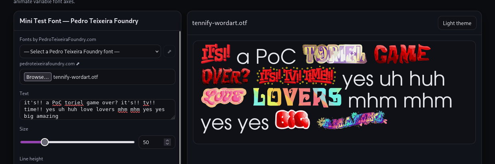

# Tennify

---

Ever wanted to have your font include Tenna Deltarune's wordart?
Well now you can. This is basically a PoC script to add wordart
into an arbitrary .otf font via (ab?)using the ligature GSUB tables.

**Example:**


## Why?
Why not. Think of it like this: Tenna Deltarune is now in your phone
and is speaking to you. Isn't that kinda awesome? I think so too.

## How?
I took the wordarts from here: [Spriters Resource](https://www.spriters-resource.com/pc_computer/deltarune/asset/273270/)
vectorize them and then just add ligatures to a font.. it's really not that deep..

## How can I use it?
There's a web version of this script [here](https://tenna.pseudoephedr.in/). But you can also just
download the script and use it locally! Just run:

```bash
uv sync
uv run python build_wordart_font.py path/to/font.otf -o out/font.otf
```

and that's it! just use the output font and enjoy the ligatures.

## Does this actually work?
It works on my machine but ymmv obviously